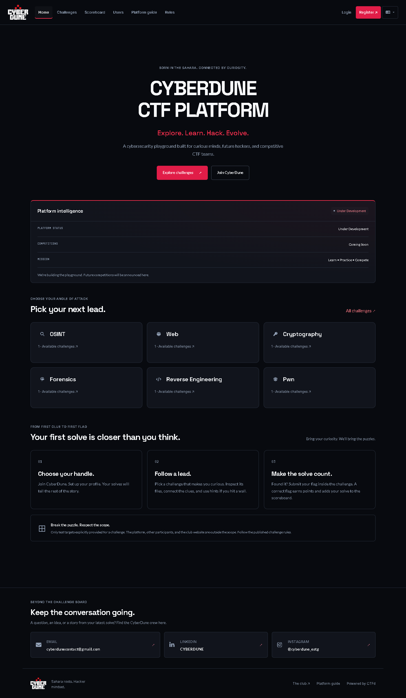

# CyberDune CTF

The requested theme from **core-theme.zip** is now included as **core-theme**.
The activation helper selects it by default. See the
[supplied theme guide](docs/SUPPLIED-THEME.md) for activation and rollback.

**Follow the clues. Find your flag.**

The CyberDune club's Capture The Flag platform, built on **CTFd 3.8.8**.
A custom black/red theme brings the club's identity to challenges, accounts,
teams and standings, with English, French and Arabic copy.

[Club website](https://cyberdune.online) ·
[Instagram](https://www.instagram.com/cyberdune_estg/) ·
[LinkedIn](https://www.linkedin.com/company/cyberdune/) ·
[Email](mailto:cyberdunecontact@gmail.com)



## What is included

Admin instance challenges can now be created from a ZIP through **Challenges →
New Challenge → Upload instance ZIP**. The worker builds the included Dockerfile
and registers the challenge automatically. See the
[ZIP upload guide](docs/ZIP-INSTANCE-CHALLENGES.md).

- Official CyberDune logo and responsive theme.
- Ready platform landing with premium CYBERDUNE branding and explicit future Event Mode.
- Clean club-branded hero, readable category cards and restrained red accents.
- Reduced-motion support and finite highlights for real score/solve updates.
- Clean club-branded hero, readable category cards and restrained red accents.
- Reduced-motion support and finite highlights for real score/solve updates.
- Authorized challenge categories; real metrics and standings preview in Event Mode.
- Local typography, recovery page and rank-preserving scoreboard search.
- English, French and Arabic language choices, with RTL support for Arabic.
- Challenge search and category/solve filters, using real CTFd data.
- CTFd registration, teams, hints, flags, dynamic scoring and standings.
- Codespaces configuration, startup/update scripts and VS Code tasks.

The terminal is an illustration; it does not execute commands. Challenge content,
event dates and registration rules are managed through the CTFd admin panel.

Platform Mode is active by default, even when old dates exist. See the
[mode guide](docs/PLATFORM-MODE.md) for safe timing cleanup and the exact
admin procedure to announce a real future competition.

## Project layout

```text
CTFd/                      CTFd application
  themes/cyberdune/         CyberDune templates, CSS, JavaScript and logos
  themes/core/              Upstream theme assets used by the custom theme
conf/                      Nginx configuration
migrations/                Database migrations
scripts/                   Start, update and theme activation helpers
.devcontainer/             GitHub Codespaces configuration
.vscode/                   Editor tasks
docs/                      Setup, theme and validation notes
tests/                     Upstream CTFd tests
docker-compose.yml         Local/Codespaces services
.data/                     Runtime database, uploads and logs (ignored by Git)
```

## Run in GitHub Codespaces

Docker runs **inside Codespaces**. You do not need Docker installed on your Windows PC.

1. Open this repository on GitHub → **Code → Codespaces → Create codespace on master**.
2. Wait for the dev container setup and initial application build. The startup
   hook runs `bash scripts/start-cyberdune.sh` each time the Codespace starts.
3. Open the **Ports** tab and open **port 80** in your browser. Keep it private
   while configuring the event.
4. For a new database, complete `/setup` and create your administrator account.
5. Select the theme once:

   ```bash
   docker compose exec ctfd python scripts/activate-cyberdune.py
   docker compose restart ctfd
   ```

If old CyberDune CSS is still pasted in Theme Header/Footer, follow the backed-up
activation procedure in [the theme guide](docs/THEME.md).

Your data lives in `.data/` inside this Codespace. GitHub stores source code, not
your users, challenge records, flags, scores or database. Back up event data through
**Admin → Config → Import & Export** before deleting or replacing a Codespace.
Codespaces is the development environment; keep persistent public hosting separate.

## Update your existing Codespace

Before the **first pull**, save changes you already made in the Codespace:

```bash
cd /workspaces/CTFd
git status --short
git stash push --include-untracked -m "Before CyberDune repository update"
git pull --ff-only origin master
bash scripts/start-cyberdune.sh
docker compose restart ctfd
```

Stashed files remain recoverable with `git stash list` / `git stash show`.
Review them before restoring; the updated repository already contains the theme
and startup fixes. `.data/` is ignored and is not included in that stash.
If Git reports an untracked ignored theme file would be overwritten, see the
[existing Codespace guide](docs/CODESPACES.md) before retrying.

For later updates, use:

```bash
bash scripts/update-cyberdune.sh
```

Then refresh your browser with **Ctrl+Shift+R**. The update script stops if there
are local edits, pulls without rewriting history, starts the services and restarts
CTFd. It does not remove data or automatically apply stashed changes.

If you want the new container configuration in an **existing** Codespace, use
**Codespaces: Rebuild Container** after pulling. See [Codespaces notes](docs/CODESPACES.md).

## Edit on your PC and publish to GitHub

Open the local **`platform`** folder in VS Code. Use PowerShell in that folder:

```powershell
git status
git add CTFd/themes/cyberdune README.md docs scripts .devcontainer .vscode
git diff --cached --stat
git commit -m "Update CyberDune platform"
git push origin master
```

Review the staged files before committing. Never commit actual flags, passwords,
tokens, database exports, uploads or `.data/`.
For the first local commit, Git may ask for your identity; set your own name and
GitHub no-reply email with `git config user.name` and `git config user.email`.
GitHub sign-in for pushing is handled by your Git credential manager or VS Code.

Then run `bash scripts/update-cyberdune.sh` in the Codespace. You no longer need
to upload a theme ZIP for each edit.

## Where to make changes

To give another person administrator access, open **Admin Panel → Users → their
account → Manage admin access**, select **Admin** under **Account role**, and
submit. See [admin access instructions](docs/ADMIN-ACCESS.md) for granting and
revoking access.

| Change | File or interface |
| --- | --- |
| Colors, spacing and responsive layout | `CTFd/themes/cyberdune/static/css/cyberdune.css` |
| Branded text in all three languages | `CTFd/themes/cyberdune/templates/components/copy.html` |
| Homepage layout | `CTFd/themes/cyberdune/templates/components/landing.html` |
| Navigation | `CTFd/themes/cyberdune/templates/components/navbar.html` |
| Official contact links | `CTFd/themes/cyberdune/templates/components/contacts.html` |
| Schedule, live metrics and UI behavior | `CTFd/themes/cyberdune/static/js/cyberdune.js` |
| CSS/JS cache version | `CTFd/themes/cyberdune/templates/base.html` |
| Challenges, flags, hints and dates | CTFd admin panel |

Keep the core theme installed: CyberDune reuses its compiled assets and fallback
templates. No npm build is needed for edits to the custom CSS, JS or templates.
Changing Python dependencies or the Dockerfile requires a container image rebuild:
`docker compose up -d --build`.

## Documentation and validation

- [Actual Google Stitch project, screen IDs and exported designs](docs/stitch/README.md)
- [Local Stitch reference gallery](docs/stitch/gallery.html)

- [Existing Codespace update and troubleshooting](docs/CODESPACES.md)
- [Theme installation, backup and rollback](docs/THEME.md)
- [Completed checks and validation limits](docs/VALIDATION.md)
- [Original upstream CTFd README](docs/CTFD-UPSTREAM.md)
- [CTFd documentation](https://docs.ctfd.io/)

Theme checks used an isolated local CTFd database and browser tests. The new
Codespace container configuration must be verified in GitHub Codespaces; it was
not built on the Windows PC.

## Credits and license

CTFd is developed by [CTFd](https://github.com/CTFd/CTFd) and distributed under
the [Apache License 2.0](LICENSE). This repository retains the upstream code,
license and history. CyberDune supplies the club branding and custom theme.
## Optional challenge instances

The `dynamic_iac` challenge type is included for challenges that need per-user
or per-team environments. Backend activation, image/scenario authoring and
deployment verification are documented in [docs/INSTANCES.md](docs/INSTANCES.md).
Normal Docker Compose startup keeps this backend off.
